# Connectly


Connectly is a professional networking web app inspired by platforms like LinkedIn. You can share updates, explore profiles, grow a network, browse and apply to jobs, message people and follow notifications.

It is a **front-end demo**. All data is mock data that ships with the repository. Your changes are saved to your browser's `localStorage`, so the app runs locally with no database, no paid API and no secret environment variables.

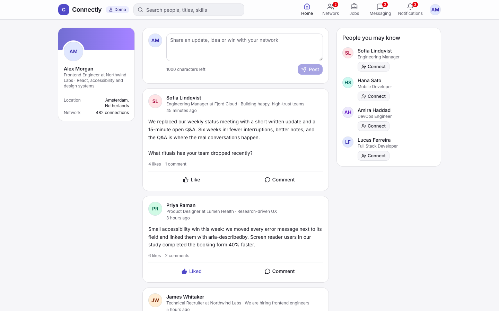

## Table of contents

- [Features](#features)
- [Screenshots](#screenshots)
- [Tech stack](#tech-stack)
- [Getting started](#getting-started)
- [Available scripts](#available-scripts)
- [Demo account](#demo-account)
- [Mock data and persistence](#mock-data-and-persistence)
- [Mock API](#mock-api)
- [Architecture](#architecture)
- [Testing](#testing)
- [Accessibility and responsive design](#accessibility-and-responsive-design)
- [Deployment](#deployment)
- [Known limitations](#known-limitations)

## Features

Every feature below runs on mock data. In the UI, a **Demo** badge marks anything simulated.

**Account**
- Demo sign-in with validated email and password, plus a one-click demo account
- Protected app routes that send you back to the page you asked for after sign-in
- Sign out and **Reset demo data** in the profile menu

**Feed**
- Create posts with a character limit and validation
- Like and unlike posts (`aria-pressed`), add comments, delete your own posts
- Profile summary card and "People you may know" sidebar

**Profiles**
- Profile pages with about, experience, education and skills
- Skill badges link to a filtered people search
- Edit your profile (name, headline, title, company, location, about, skills) with inline validation

**Search and network**
- People search by keyword, job title and skill, synced to the URL
- Connection requests: connect, withdraw, accept, ignore and remove (simulated)
- Message and Connect actions on other members' profiles

**Jobs**
- Job listings with keyword, workplace, job type and experience filters
- Save jobs with a bookmark and see them under **Saved**
- Job detail pages with a validated, simulated application form and an **Applied** view

**Messaging and notifications**
- Conversation list with unread state and a two-pane layout on desktop
- Send messages. Each one triggers an automated demo reply, which the UI labels as such
- Notifications with All/Unread filters, mark one as read, or mark all as read
- Unread counts in the navigation for invitations, conversations and notifications

**States**
- Loading skeletons, error states with retry, and empty states for search, jobs, feed, network and notifications
- A custom 404 page for unknown routes, profiles and jobs

## Screenshots

All screenshots come from the running application.

| Sign in | Profile |
| --- | --- |
| 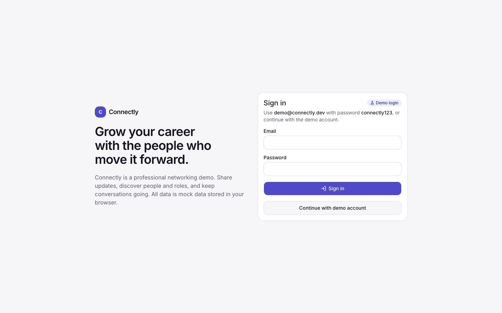 | 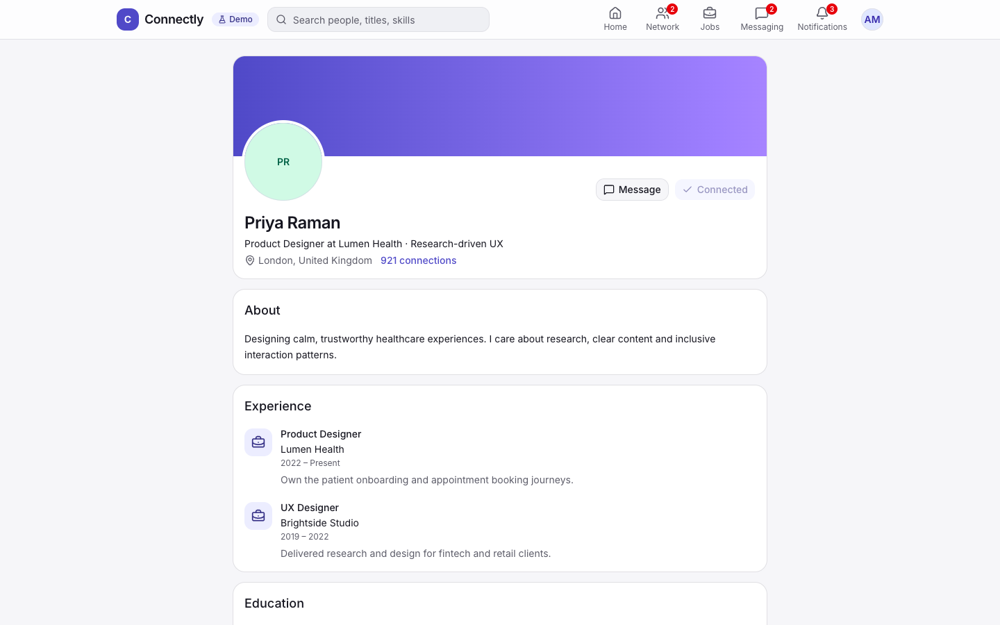 |

| People search | My network |
| --- | --- |
| 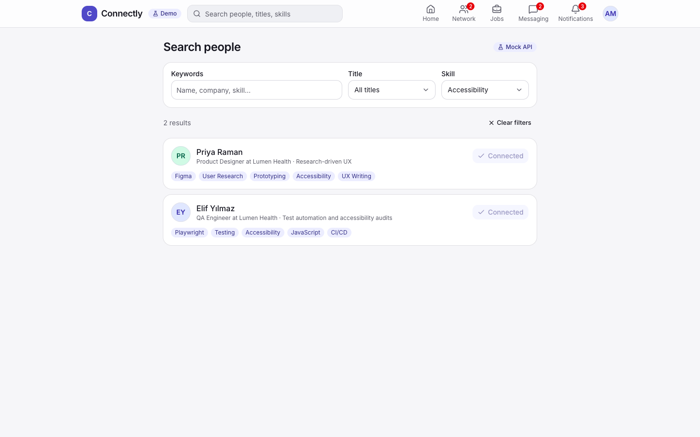 | 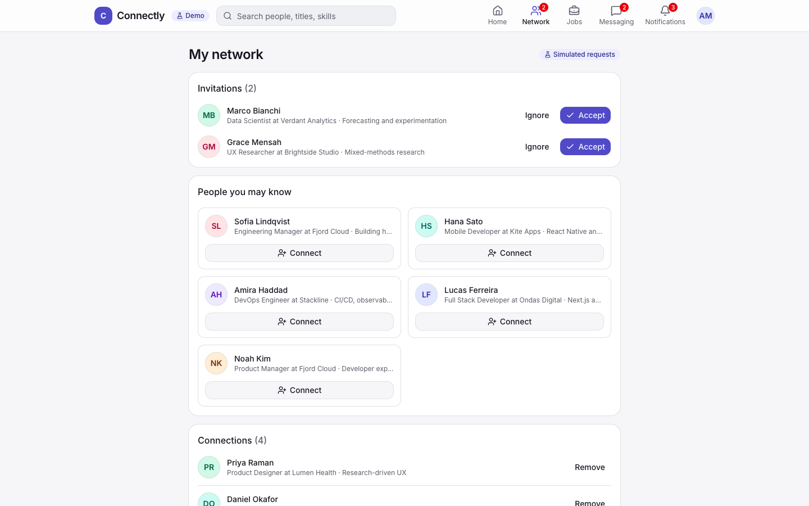 |

| Jobs | Job application |
| --- | --- |
| 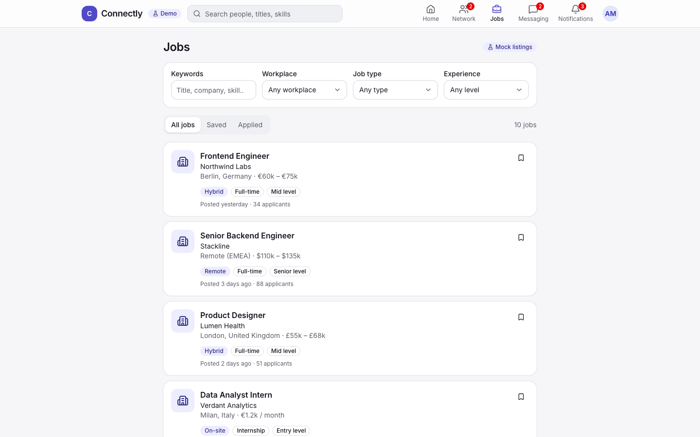 | 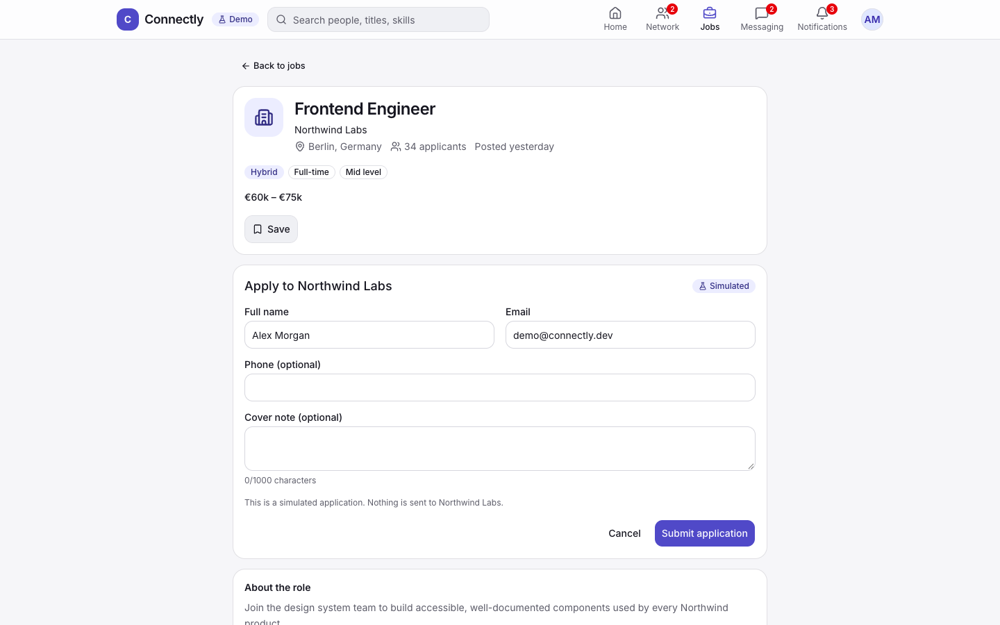 |

| Messaging | Notifications |
| --- | --- |
| 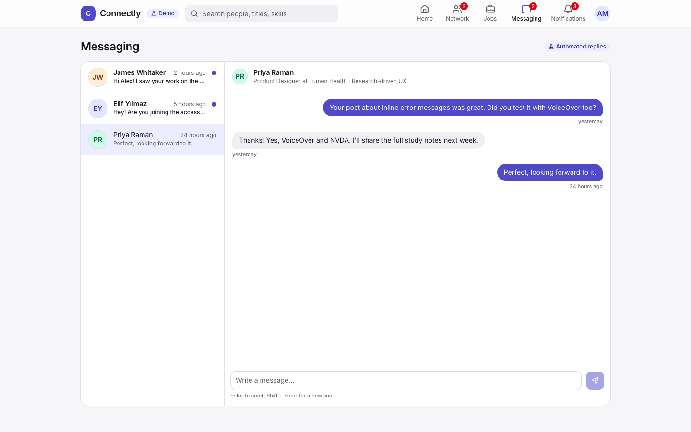 | 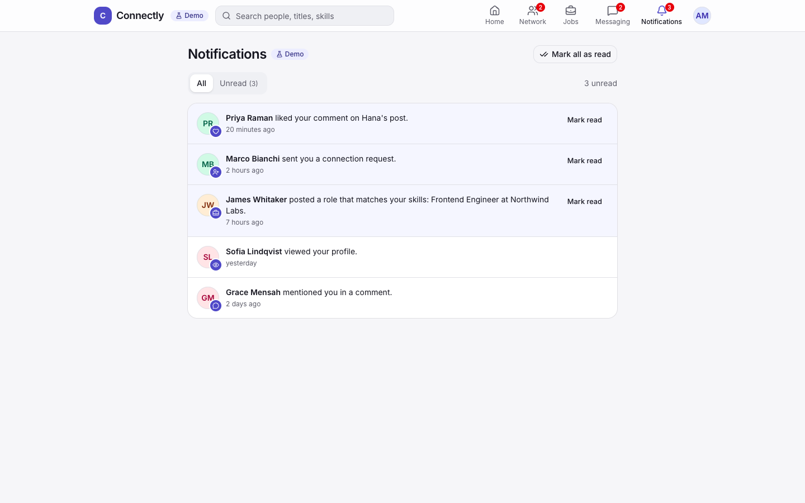 |

| Mobile feed | Mobile profile |
| --- | --- |
| 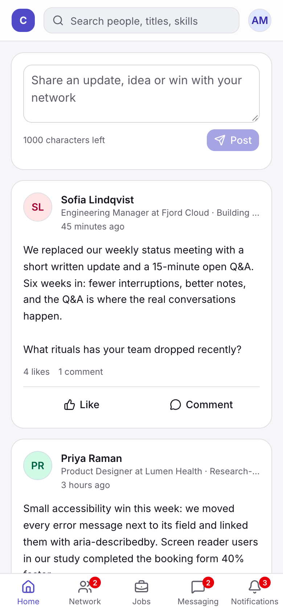 | 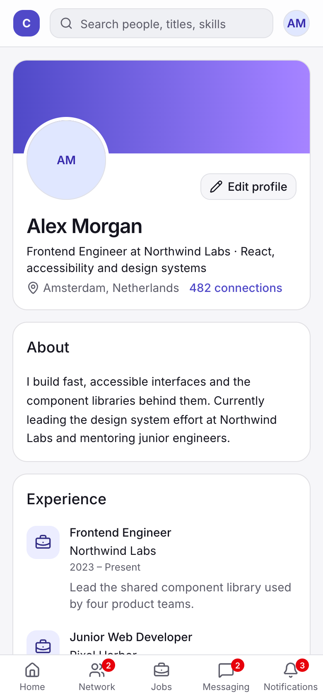 |

## Tech stack

| Area | Choice |
| --- | --- |
| Framework | [Next.js 16](https://nextjs.org/) App Router (Server Components by default) |
| UI | React 19, JavaScript (no TypeScript) |
| Styling | Tailwind CSS v4 with CSS-variable design tokens |
| Components | [shadcn/ui](https://ui.shadcn.com/) on Radix primitives, [Lucide](https://lucide.dev/) icons |
| State | A small external store built on `useSyncExternalStore` and persisted to `localStorage` |
| Testing | Vitest, React Testing Library, jsdom |
| Linting | ESLint (`eslint-config-next`) |

## Getting started

Requirements: **Node.js 20.9 or newer** (developed on Node 22) and npm.

```bash
git clone https://github.com/zeynepbass/connectly-professional-network.git
cd connectly-professional-network
npm install
npm run dev
```

Open [http://localhost:3000](http://localhost:3000). You will be sent to the sign-in page.

No `.env` file is needed.

## Available scripts

| Script | Description |
| --- | --- |
| `npm run dev` | Start the development server |
| `npm run build` | Create a production build |
| `npm start` | Serve the production build |
| `npm run lint` | Run ESLint |
| `npm test` | Run the test suite once |
| `npm run test:watch` | Run tests in watch mode |

## Demo account

| Field | Value |
| --- | --- |
| Email | `demo@connectly.dev` |
| Password | `connectly123` |

You can also click **Continue with demo account**. You sign in as *Alex Morgan, Frontend Engineer at Northwind Labs*.

These credentials only exist in the client-side mock data. They are not a real account and protect nothing.

## Mock data and persistence

- **Seed data** is in `src/data/` as plain JavaScript modules: `users.js`, `posts.js`, `jobs.js`, `connections.js`, `conversations.js` and `notifications.js`. UI components never import raw data directly. They go through helpers in `src/lib/` or store selectors.
- **Timestamps** are stored as relative offsets (`minutesAgo`, `postedDaysAgo`), so the demo content always looks recent.
- **Demo state** (session, posts, likes, comments, profile edits, connections, saved jobs, applications, messages, notification read state) lives in a small store in `src/lib/store/`:
  - `reducer.js` holds pure state transitions, which are easy to unit test
  - `actions.js` holds the action creators used by components
  - `selectors.js` holds derived data, such as merging profile edits over seed profiles
  - `store.js` loads from and saves to `localStorage` under the key `connectly:demo-state`, and syncs open tabs
- **Reset demo data** in the profile menu restores the seed data and keeps you signed in.

## Mock API

Next.js route handlers expose read-only endpoints backed by the same mock data. They add about 350 ms of artificial latency so the loading states are visible. The people search and jobs pages fetch from these endpoints in the browser.

| Endpoint | Query parameters | Response |
| --- | --- | --- |
| `GET /api/users` | `q`, `title`, `skill` | `{ data: User[], total }` (public profile fields) |
| `GET /api/users/[username]` | – | `{ data: User }` or `404` |
| `GET /api/jobs` | `q`, `workplace`, `type`, `level` | `{ data: Job[], total }` |
| `GET /api/jobs/[id]` | – | `{ data: Job }` or `404` |

Add `simulateError=1` to either list endpoint to get a `500` response. This is useful for checking error handling:

```bash
curl "http://localhost:3000/api/users?skill=Figma"
curl "http://localhost:3000/api/jobs?workplace=Remote&level=Senior"
curl -i "http://localhost:3000/api/jobs?simulateError=1"
```

## Architecture

```
src/
├── app/                      # Routes (App Router)
│   ├── (main)/               # Authenticated app shell: header, mobile nav, auth gate
│   │   ├── feed/             # Home feed
│   │   ├── profile/[username]/
│   │   ├── settings/profile/ # Profile editing
│   │   ├── search/           # People search
│   │   ├── network/          # Invitations, suggestions, connections
│   │   ├── jobs/ and jobs/[id]/
│   │   ├── messages/
│   │   └── notifications/
│   ├── api/                  # Mock REST endpoints (users, jobs)
│   ├── sign-in/
│   ├── layout.js
│   └── not-found.js
├── components/
│   ├── ui/                   # shadcn/ui primitives
│   ├── layout/               # Header, mobile nav, profile menu, logo
│   └── shared/               # Avatar, empty/error states, form field, demo badge…
├── features/                 # Feature modules: auth, feed, profile, search,
│                             # network, jobs, messages, notifications
├── data/                     # Mock seed data
├── hooks/                    # useFetchJson, useDebouncedValue
├── lib/                      # Validation, search/filter helpers, formatting, store
└── test/                     # Test setup and helpers
```

Design decisions:

- **Server Components first.** Route files are Server Components. They read route params, call `notFound()` for unknown profiles and jobs, set metadata, and pre-render known profile and job pages with `generateStaticParams`. Interactive pieces are Client Components inside `src/features/`.
- **One store, no extra libraries.** `useSyncExternalStore` gives every component a consistent snapshot with no provider tree and no state-management dependency.
- **Auth gate.** Mock auth lives only in the browser, so the `(main)` layout renders a skeleton until the store loads, then either shows the app or redirects to `/sign-in?next=…`. Redirect targets are checked to block open redirects.
- **Feature boundaries.** Components for each feature live together. Shared building blocks live in `components/shared`. Data access goes through `lib/` helpers and selectors.

## Testing

```bash
npm test
```

The suite uses Vitest with React Testing Library and covers:

- **Unit:** form validation, people search and facets, job filters, relative time formatting, and every store reducer case and selector
- **API:** each route handler, including filters, `404` responses and simulated errors (node environment)
- **Components:**
  - sign-in validation and redirect
  - creating, liking, commenting on and deleting posts
  - connection button states
  - people search loading, empty and error/retry states
  - saving a job and the application form
  - notification read state

Test files sit next to the code they cover (`*.test.js` / `*.test.jsx`).

## Accessibility and responsive design

- Semantic landmarks, a **Skip to content** link, one `h1` per page, and section headings in order
- Every form control has a label. Errors are linked with `aria-describedby`, inputs are marked `aria-invalid`, and focus moves to the first invalid field on submit
- Toggle buttons expose `aria-pressed`. The comment toggle exposes `aria-expanded` and moves focus to the comment field
- Live regions announce published posts, result counts and new messages
- Visible focus rings on all interactive elements, plus full keyboard support in the profile menu (Radix)
- Reduced motion is respected through `prefers-reduced-motion`
- Layout:
  - Mobile: one column with a bottom navigation bar
  - Tablet: two columns
  - Desktop: a three-column feed and a two-pane messaging view

**How this was checked:** axe-core (WCAG 2.0/2.1 A and AA plus best-practice rules) was run against every main page at 1280 px and 360 px with no violations reported. Horizontal overflow was checked at 360 px. Automated checks do not catch every issue, so manual screen-reader testing is still recommended.

## Deployment

The app needs no environment variables, so it can be deployed to any Node.js host that supports Next.js. One option is Vercel's free Hobby plan:

1. Push the repository to GitHub. It can stay private.
2. Sign in at [vercel.com](https://vercel.com) with GitHub and choose **Add New → Project**.
3. Import `connectly-professional-network`. Vercel detects Next.js automatically, so the default build settings (`npm run build`) work.
4. Click **Deploy**.

Hobby plan limits and terms can change. At the time of writing, it is for personal, non-commercial use and has usage quotas. Check Vercel's current pricing page before relying on it.

To self-host instead, run `npm run build` and then `npm start` (port 3000 by default).

> This repository does not include a live deployment link yet.

## Known limitations

- **Mock authentication only.** The session and credentials live on the client. Nothing here is secure or meant for real users.
- **Data is per browser.** Posts, edits and messages are saved to `localStorage` and are not shared between browsers or devices. Clearing site data, or using **Reset demo data**, restores the seed data.
- **The mock API only reads seed data.** People search results come from seed profiles, so profile edits made in the browser appear on cards but don't change which profiles match a search.
- **Automated replies are canned.** Message replies are fixed strings, and notifications are pre-seeded rather than triggered by your actions.
- **No image uploads.** Avatars are generated initials and company logos are icons.
- **Dev tooling advisories.** `npm audit` reports high-severity advisories in development-only dependencies (pulled in by the shadcn CLI). `npm audit --omit=dev` reports none for the production dependencies.
